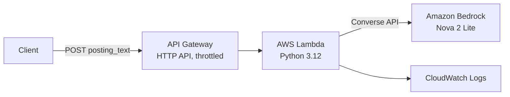

# Job Posting Analyzer

A serverless API that extracts structured fields from internship job postings using
Amazon Bedrock, with a **grounding check**: every extracted field must be backed by an
exact quote from the posting, and the code verifies that quote is really there.

## Why

I was applying to dozens of internships and tracking them by hand: copying deadlines,
noting required skills. This service turns a pasted posting into structured data my
[Job Application Tracker](https://github.com/arshdhothar) can use. A hallucinated
deadline means a missed application, so the output has to be verifiable, not just plausible.

## Architecture



## How it works

1. **Extract**: Nova 2 Lite returns 8 fields as JSON (company, role, location, work mode,
   term, deadline, required and nice-to-have skills). Each value comes with a quote
   from the posting. Temperature 0 for consistent output.
2. **Validate + retry**: if the JSON is broken or fields are missing, the model is
   called once more with the exact errors. After two failures the request fails loudly
   instead of returning bad data.
3. **Enforce rules in code**: the model doesn't reliably follow every prompt rule
   (e.g. it labelled "internship" as a work term despite being told not to). Rules that
   code can check are enforced deterministically, and every change is reported in `fixes`.
4. **Grounding check**: each quote is normalized (quote marks, dashes, whitespace, case)
   and checked against the posting. Unsupported fields are marked `grounded: false`
   and listed in `flagged`.

**Known limitation:** grounding proves the evidence exists, not that the model
interpreted it correctly. Interpretation errors are what the evaluation (below) measures.

## Example

```bash
curl -X POST "$API_URL" -H "Content-Type: application/json" \
  -d '{"posting_text": "Acme Corp is hiring a Software Developer Intern in Toronto, hybrid, for Winter 2027. Apply by November 30, 2026. Required: Python and SQL. Nice to have: AWS."}'
```

```json
{
  "company": {"value": "Acme Corp", "quote": "Acme Corp is hiring a Software Developer Intern in Toronto, hybrid, for Winter 2027.", "grounded": true},
  "deadline": {"value": "November 30, 2026", "quote": "Apply by November 30, 2026.", "grounded": true},
  "required_skills": [{"value": "Python", "quote": "Required: Python and SQL.", "grounded": true}],
  "fixes": [],
  "flagged": []
}
```
(abridged)

## Security and cost controls

- **Least privilege**: the Lambda console's default gave the function a power-user
  role. I replaced it with a dedicated role that can only write logs and call
  `bedrock:InvokeModel` on one model, verified by confirming an `AccessDeniedException`
  before granting the permission.
- **Data residency**: uses the `us.` inference profile, so requests are processed in the US.
- **Abuse limits**: API Gateway throttling (burst 5, 1 req/s), a 20,000-character input
  cap, and input validation that rejects bad requests before any model call.
- **Error handling**: internal errors are logged to CloudWatch; callers see a generic message.
- **Credentials**: none in code. Locally, boto3 uses the AWS CLI profile; on Lambda, the role.

## Performance and cost

- Typical latency: 1–3 s per posting, almost all of it the model call. Cold start ≈ 0.5 s.
- Cost: well under a cent per posting (most of it output tokens, mainly the quotes).
- Under a burst of 20 parallel requests, the account's Lambda concurrency limit (10)
  produced `503`s for the excess, while API Gateway throttling returned `429`. Clients
  should retry both with backoff.

## Evaluation

In progress: 26 real postings, hand-labeled using written [annotation guidelines](LABELING.md)
before seeing any model output. Results will report per-field accuracy, how often grounding
catches errors, and cost/latency across prompt versions.

The postings themselves aren't included in this repo because they're third-party content;
labels and results will be.

## Run locally

Requires Python 3.12 and AWS credentials with Bedrock access (us-east-2).

```bash
python3.12 -m venv .venv && source .venv/bin/activate
pip install boto3
python extractor.py path/to/posting.txt
```

## Roadmap

- Evaluation harness and prompt comparison
- Resume-to-posting matching with retrieval (RAG)
- Infrastructure as code (AWS SAM) with deploys from GitHub Actions